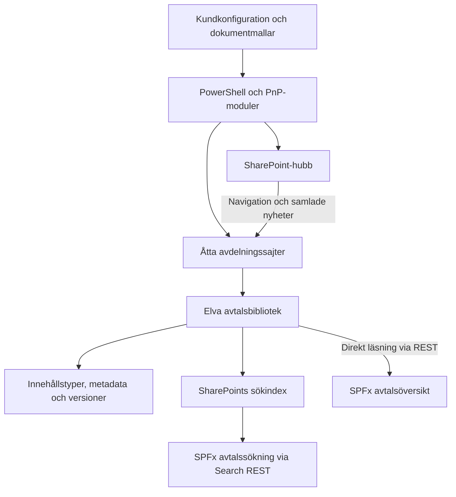
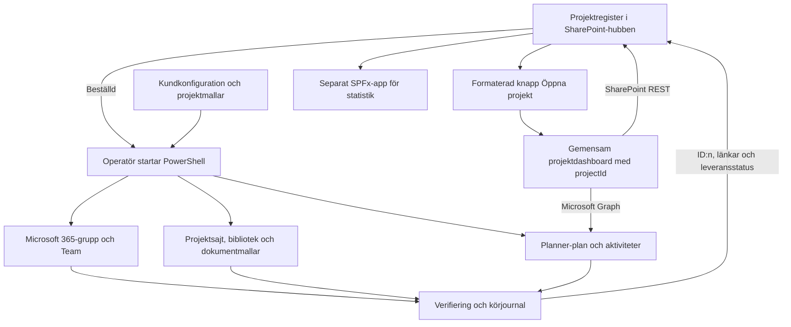
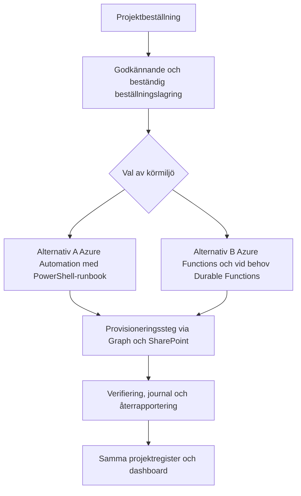

# Arkitektur och designval

[Till portföljens startsida](README.md)

Diagrammen visar piloternas uppbyggnad. Produktionsalternativen längst ned är en målbild och är inte driftsatta.

## Avtalsportalen i piloten

Sökningen använder indexet för fritext och filtrering. Översikten läser metadata direkt för uppföljning av ansvar, slutdatum och uppsägningsdag. Båda följer den inloggade användarens åtkomst.

## Projektportalen i piloten

## Principer i utvecklingen

- **Konfiguration före kopierad kod.** Bibliotek, metadata och projektmallar kan anpassas per kund genom konfiguration.
- **Avgränsade ändringar.** Befintliga resurser och ägarmarkörer kontrolleras innan ändring. Journal och resurs-ID:n stödjer kontrollerad återupptagning.
- **Olika ansvar för klient och körmotor.** SPFx använder användarens kontext. Administrativa provisioneringsoperationer körs separat, utan administratörshemligheter i klientkoden.
- **Verifiering efter skapande.** En returnerad API-respons är inte ensam ett kvitto på en färdig arbetsyta. Resurser och konfiguration läses tillbaka.
- **Separata apppaket.** Sökning, avtalsöversikt, projektdashboard och statistik kan byggas och uppdateras oberoende.

## Målbild för obevakad projektprovisionering

Automation och Functions är alternativa körmiljöer, inte två obligatoriska tjänster. Power Automate kan användas för godkännande och jobbstart. Piloten använder inget av dessa bakgrundsflöden.

Före produktion behöver API-stöd för obevakad identitet verifieras per operation. Beständig lagring, köhantering, samtidighet, övervakning, återförsök, licenser och driftansvar behöver fastställas. Dagens delegerade inloggning kan inte utan vidare ersättas med samma behörighetsmodell i ett bakgrundsjobb.
