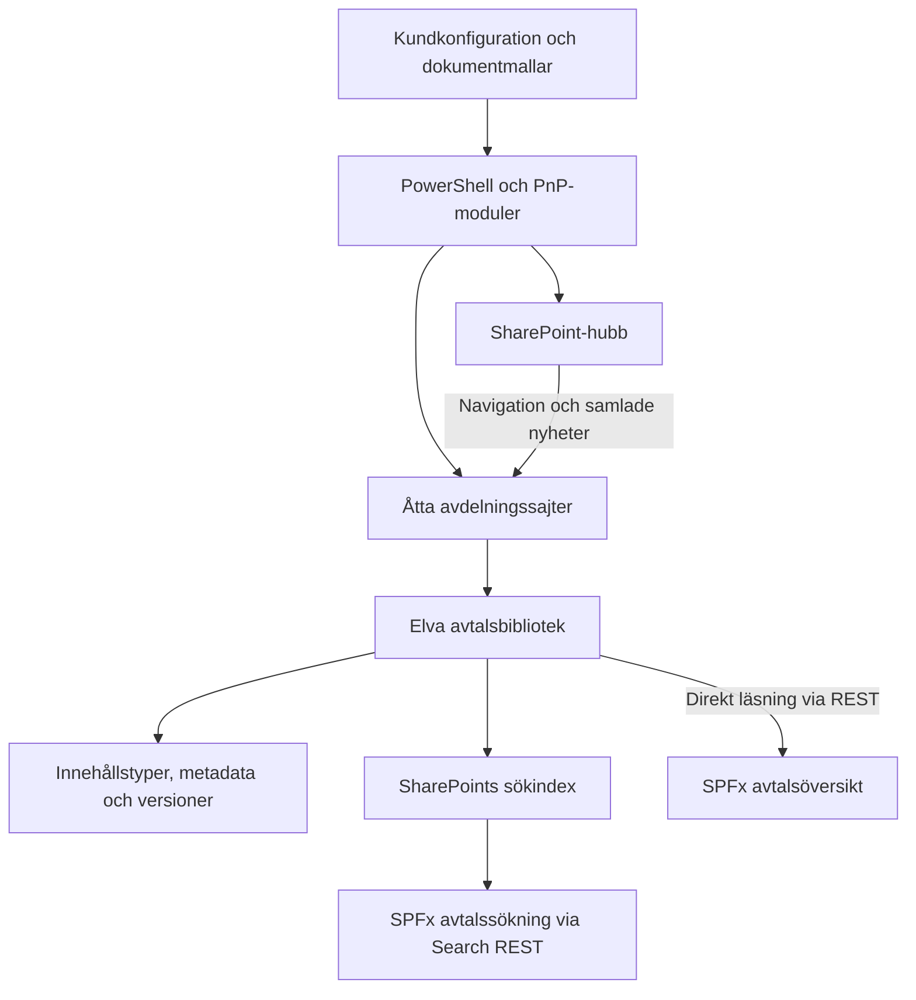
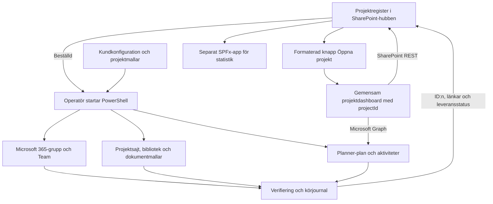
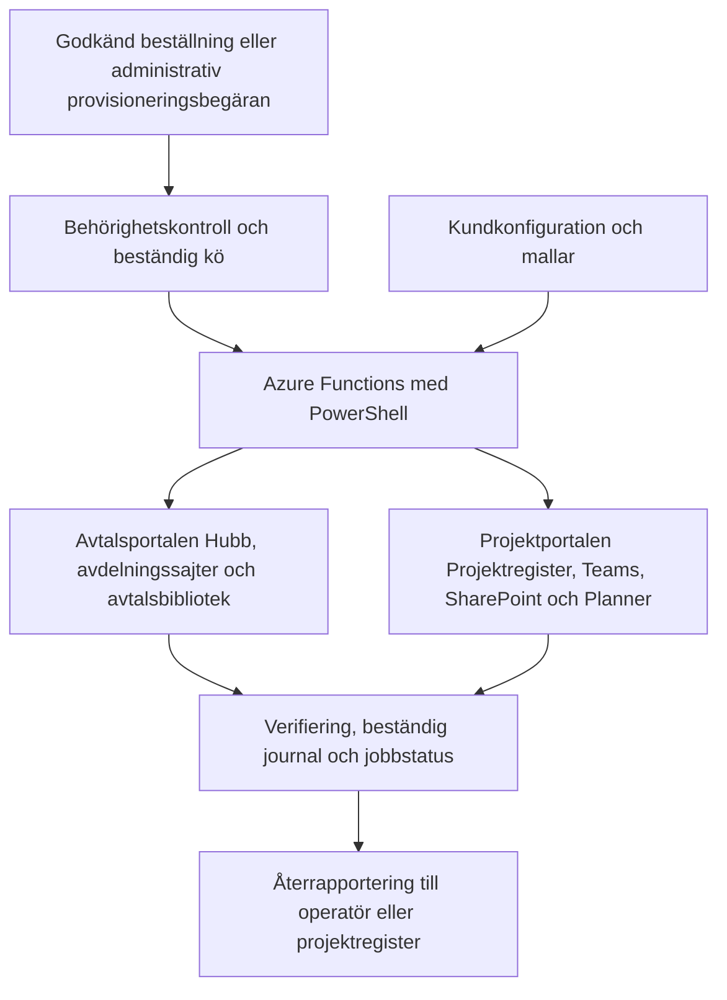

# Arkitektur och designval

[Till portföljens startsida](README.md)

Diagrammen visar piloternas uppbyggnad. Produktionsalternativen längst ned är en målbild och är inte driftsatta.

## Avtalsportalen i piloten

Sökningen använder indexet för fritext och filtrering. Översikten läser metadata direkt för uppföljning av ansvar, slutdatum och uppsägningsdag. Båda följer den inloggade användarens åtkomst.

## Projektportalen i piloten

## Medarbetarservice i piloten

SPFx-webbdelen på SharePoint-sajten läser **Ingångar → Tjänster → Produktkatalog**. Uppslagskolumner styr vilka tjänster och produkter som hör till respektive val. Utrustningsformuläret använder medarbetarens SharePoint-behörighet för att spara en post i **Beställningar**. Behörighetsbegäran öppnar SharePoints formulär för sin innehållstyp.

PowerShell provisionerar sajten, listorna, innehållstyperna och webbdelen i ordning. En kundkonfiguration kan lägga till beställningstyper och kolumner som definieras under workshoppen. [Projektcase och diagram för Medarbetarservice](projekt/medarbetarservice.md)

## Principer i utvecklingen

- **Konfiguration före kopierad kod.** Bibliotek, metadata och projektmallar kan anpassas per kund genom konfiguration.
- **Avgränsade ändringar.** Befintliga resurser och ägarmarkörer kontrolleras innan ändring. Journal och resurs-ID:n stödjer kontrollerad återupptagning.
- **Olika ansvar för klient och körmotor.** SPFx använder användarens kontext. Administrativa provisioneringsoperationer körs separat, utan administratörshemligheter i klientkoden.
- **Verifiering efter skapande.** En returnerad API-respons är inte ensam ett kvitto på en färdig arbetsyta. Resurser och konfiguration läses tillbaka.
- **Separata apppaket.** Sökning, avtalsöversikt, projektdashboard och statistik kan byggas och uppdateras oberoende.

## Gemensam målarkitektur med Azure Functions

Azure Functions är vald som planerad körmiljö för PowerShell-provisioneringen i **båda portalerna**. Detta ersätter tidigare utvärdering av Automation och Functions som parallella alternativ. Azure Automation ingår inte i den valda målbilden.

För Avtalsportalen körs de administrativa stegen för portal, avdelningar, dokumentmodell och installation från en kontrollerad provisioneringsbegäran. För Projektportalen behandlas godkända projektbeställningar och resurs-ID:n, länkar och leveransstatus återrapporteras till projektregistret. Körmiljön är gemensam som arkitekturprincip; portalerna har egna moduler, konfigurationer och jobbtyper.

PowerShell-modulerna ska återanvändas med anpassad autentisering och startpunkt. Långvarig provisionering ska inte ligga i ett enda långt HTTP-anrop. Beställningen kvitteras separat och arbetet utförs i bakgrunden. Durable Functions kan utvärderas om väntesteg och orkestrering kräver det; det är inte ett beslutat krav.

Power Automate kan användas för verksamhetens godkännande eller jobbstart. Det ersätter inte provisioneringsmotorn och behövs inte enbart för att skriva tillbaka resultat. Vanlig användning av SPFx-webbdelarna fortsätter via SharePoint REST och Graph; varje dashboardvisning startar inte en Function.

**Status:** målarkitekturen är beslutad som riktning, men inga Azure Functions är implementerade eller driftsatta i piloterna. De körs fortfarande lokalt i PowerShell.

Före produktion behöver API-stöd för obevakad identitet verifieras per operation. Beständig lagring, köhantering, samtidighet, övervakning, återförsök, hosting, licenser och driftansvar behöver fastställas. Dagens delegerade inloggning kan inte utan vidare ersättas med samma behörighetsmodell i ett bakgrundsjobb. Dessa införandepunkter gäller båda portalerna.
