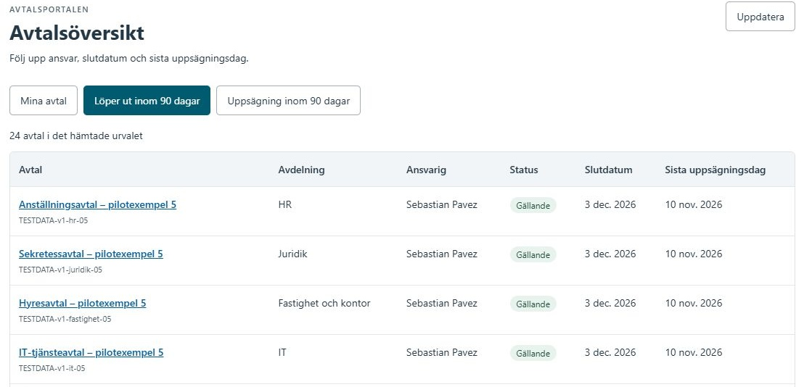
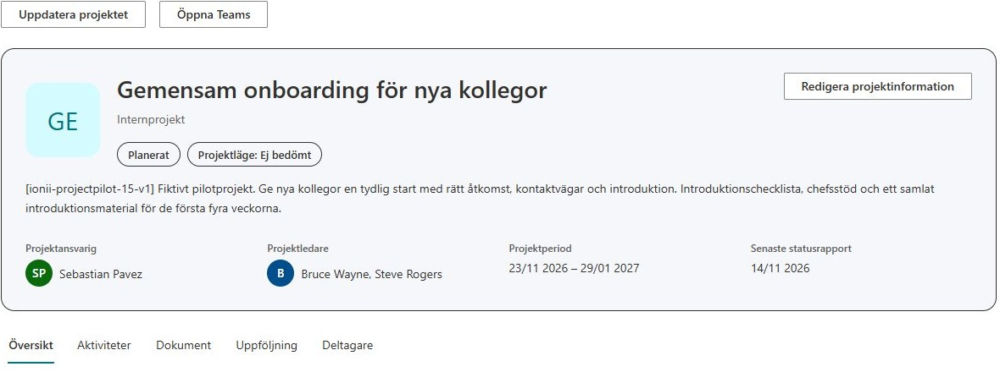
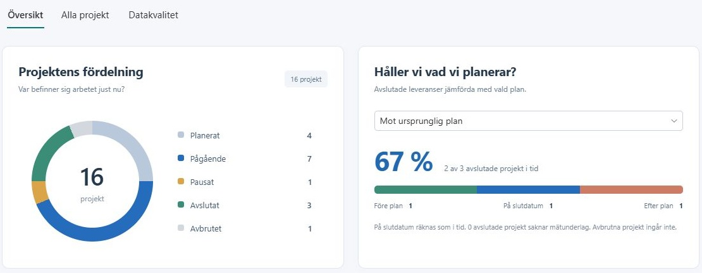

# Microsoft 365 Portfolio

**Sebastian Pavez · SharePoint · SPFx · PowerShell · Microsoft Graph**

Jag utvecklar återanvändbara lösningar för avtals- och projekthantering i Microsoft 365. Här visar jag hur jag kopplar verksamhetsbehov till informationsarkitektur, provisioneringskod och anpassade användargränssnitt.

Portföljen presenterar två egenutvecklade pilotlösningar. Arbetet omfattar krav och workshopunderlag, informationsmodellering, utveckling, installation, testning och teknisk dokumentation. Verksamhetsdata är fiktiva. Lösningarna är piloter i egen miljö, inte referenser till genomförda kunduppdrag.

## Två projektcase

| Projekt | Verksamhetsbehov | Lösning |
|---|---|---|
| [Avtalsportalen](projekt/avtalsportalen.md) | Hitta rätt avtal och följa upp ansvar och datum | SharePoint-hubb, avdelningsbibliotek, metadata, dokumentmallar, egen sökning och avtalsöversikt |
| [Projektportalen](projekt/projektportalen.md) | Samla projektbeställning, samarbete och uppföljning | Projektregister, Teams-ytor, SharePoint, Planner, projektdashboard och portföljstatistik |

### Avtalsportalen

En gemensam avtalsöversikt ger användaren en ingång till sina avtal, kommande slutdatum och sista uppsägningsdagar. Avtalen ligger kvar i respektive avdelningsbibliotek.

### Projektportalen

En gemensam dashboard visar valt projekt. Bilden visar pilotprojektet **Gemensam onboarding för nya kollegor**, med två projektledare, ansvarig, projektperiod och senaste statusrapport.

En separat statistikapp sammanställer portföljen och gör det möjligt att följa leveransprecision och projektens fördelning.

*Bilderna visar installerade piloter med testdata. Namn på projekt och verksamheter är fiktiva. Sebastian Pavez förekommer som projektansvarig och författare; övriga personnamn avser testkonton. Kontomenyer och adressfält ingår inte i bilderna.*

## Teknik och arbetssätt

- **SharePoint Online:** kommunikationssajter, hubbar, listor, dokumentbibliotek, innehållstyper, metadata, versionshantering, vyer och OOTB-webbdelar.
- **PowerShell 7 och PnP.PowerShell:** moduluppdelad provisionering, kundkonfiguration, installation, verifiering och återupptagning.
- **SPFx, React och TypeScript:** separata lösningspaket för sökning, avtalsöversikt, projektdashboard och statistik. Fluent UI används i Projektportalens gränssnitt.
- **SharePoint REST och Microsoft Graph:** register- och dokumentdata, sökning samt integration med Microsoft 365-grupper, Teams och Planner.
- **Entra ID:** appregistreringar, användaridentitet, roller och granskade API-medgivanden.
- **Git och GitHub:** versionshantering, separata paket och dokumenterad leveransordning.

Jag använder SharePoints standardfunktioner där de uppfyller behovet och bygger egna webbdelar för de sammanhållna gränssnitt som portalerna behöver. Konfiguration och provisioneringslogik hålls åtskilda för att kunna anpassas per kund.

## Arkitektur och leveransstatus

[Arkitekturdiagram och designval](ARKITEKTUR.md) visar dagens pilotlösningar och den planerade produktionsarkitekturen. [Status och verifiering](STATUS.md) skiljer mellan installerat, testat och fortsatt utveckling.

Provisioneringen i piloterna körs från lokal PowerShell. **Azure Automation, Azure Functions och automatiserat beställningsgodkännande är dokumenterade alternativ för fortsatt utveckling och är inte driftsatta.** Power Automate är ett möjligt tillägg, inte en förutsättning för dagens dashboard.

## Dokument och exempel

- [Projektbeskrivning med arkitektur, teknik och bilder som PDF](dokument/projektcase-microsoft-365.pdf)
- [Exempel på formaterad dashboardlänk](exempel/dashboardknapp.json)
- [Konfigurationsstyrd körplan i PowerShell](exempel/Visa-Provisioneringsplan.ps1)
- [Vad exemplen visar](exempel/README.md)

Detta är ett presentationsrepo. Fullständig produktkod, kundkonfiguration, körjournaler och säkerhetskopior ingår inte. Kodexemplen är fristående, generiska exempel och utgör inte ett installationspaket för portalerna.

## Om arbetet

Mitt fokus är att skapa en sammanhängande lösning från krav och informationsmodell till användargränssnitt och förvaltning. Det inkluderar workshopmallar, tekniska beslut, testunderlag och körinstruktioner som stödjer ett framtida kundinförande.

[Min GitHub-profil](https://github.com/SebastianChristobal)

Materialet är granskat för publicering utan tenantadresser, e-postadresser, åtkomsttoken eller interna konfigurationsfiler. Se [publiceringsavgränsningen](PUBLICERING.md) och [rättigheter](RATTIGHETER.md).

Senast uppdaterad 16 november 2026.
