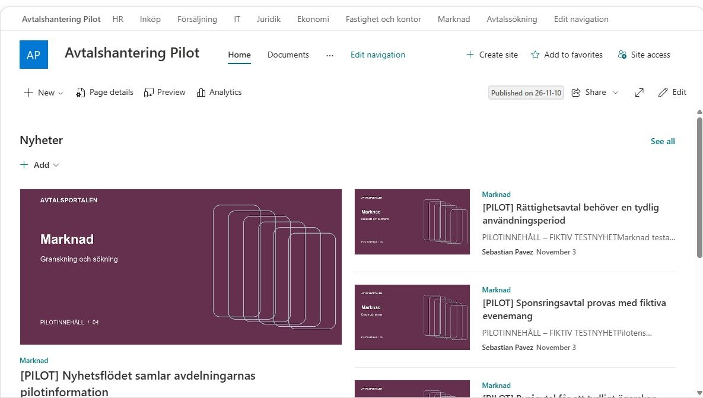
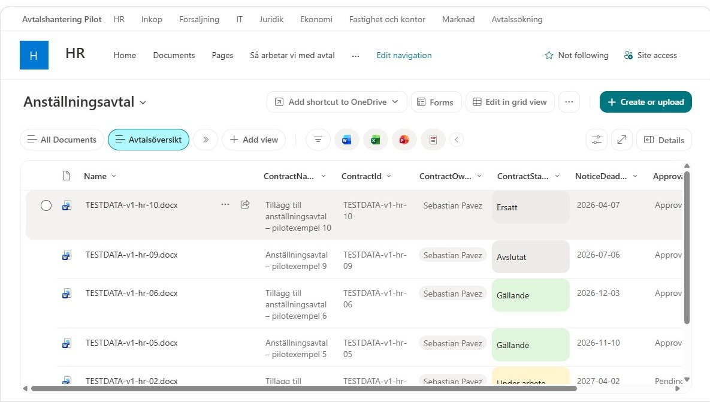
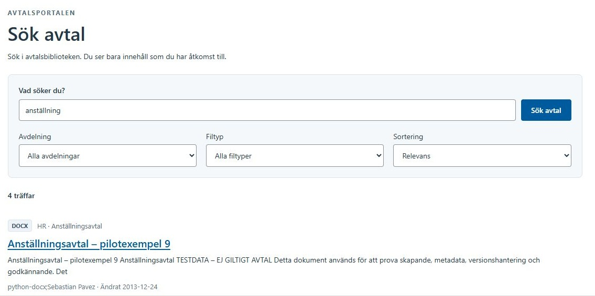
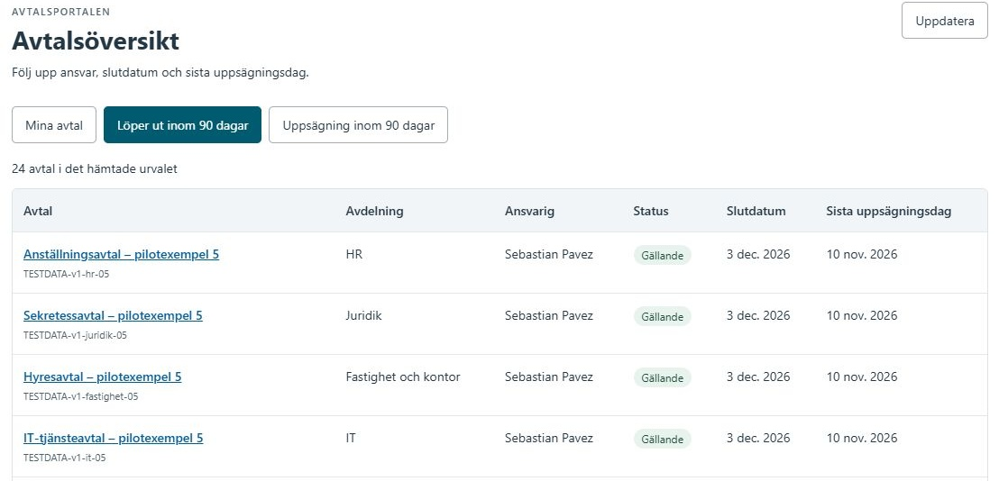

# Avtalsportalen

[Till portföljens startsida](../README.md)

## Behov och mål

Avtal behöver rätt version, tydligt ägarskap, sökbara metadata och en struktur som fungerar över avdelningar. Lösningen samlar dessa behov i en SharePoint-hubb med separata avdelningssajter.

Pilotens omfattning är **en hubb, åtta avdelningssajter och elva avtalsbibliotek**. Avdelningarna är HR, Inköp, Försäljning, IT, Juridik, Ekonomi, Fastighet och kontor samt Marknad.

## Mitt arbete

Jag tar fram informationsmodell och workshopunderlag, utvecklar konfigurationsstyrd provisionering och bygger separata SPFx-appar för avtalssökning och uppföljning. Arbetet omfattar även dokumentmallar, installationsordning, körjournaler och testunderlag.

## Dokumenthantering

Dokument skapas i första hand från bibliotekets **Nytt**-meny med rätt mall. Gemensamma innehållstyper och avdelningsspecifika kompletteringar beskriver avtalen. Dokumentuppsättningar håller ihop huvudhandling, bilagor och tillägg där det behövs.

Pilotkonfigurationen omfattar huvud- och delversioner, högst 500 huvudversioner, inbyggt innehållsgodkännande och SharePoint-grupper för läsare, medlemmar, godkännare och ägare. Fullständig rollprovning återstår före ett kundinförande.

*Hubbens nyhetsflöde hämtar publicerade pilotnyheter från anslutna sajter.*

*Biblioteksvyn visar avtalets metadata och verksamhetsstatus. Engelska interna fältnamn kombineras med svenska visningsnamn; visningen i bilden återger den aktuella piloten.*

## Två fristående SPFx-appar

### Avtalssökning

Sökwebbdelen använder **SharePoint Search REST** i användarens kontext. Den avgränsar sökningen till konfigurerade bibliotek och ger fritext, avdelningsfilter, filtypsfilter, sortering och sidindelning. Nya dokument behöver indexeras innan de visas.

*Den installerade sökningen ger fyra träffar för anställning. Bilden visar den första träffen.*

### Avtalsöversikt

Översikten läser biblioteksmetadata direkt via **SharePoint REST** och visar Mina avtal, Löper ut inom 90 dagar och Uppsägning inom 90 dagar. Datumgränser använder svensk tidszon. Översikten ändrar inte avtal och skickar inga automatiska påminnelser.

*Ett utsnitt av avtalen som löper ut inom 90 dagar, med ansvarig, status, slutdatum och sista uppsägningsdag.*

## Återanvändbar leverans

PowerShell-moduler provisionerar hubb och sajter, bibliotek, metadata, innehållstyper, mallar, vyer, sidor och navigation utifrån kundkonfiguration. SPFx-apparna har separata paket och installationssteg. Befintliga resurser kontrolleras och avbrutna körningar hanteras med journal och verifiering.

## Status

Grundportalen och SPFx-apparna är installerade i pilotmiljön. Dokumentmallar och pilotinnehåll har provats. Sökning och avtalsöversikt är kontrollerade i en autentiserad SharePoint-session. Samlad kundacceptans och fullständig behörighetsprovning återstår.

Automatisk avtals-ID-tilldelning med Power Automate är ett dokumenterat tillägg som ännu inte är byggt. Elektronisk signering och integration med externa motpartsregister är inte levererade funktioner.
