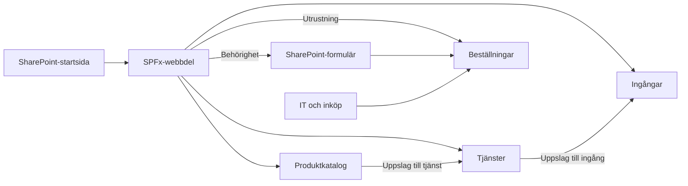

# Medarbetarservice

Medarbetarservice är en SharePoint-pilot för interna beställningar, support och onboarding. Medarbetaren hittar rätt tjänst från en gemensam startsida. IT och inköp kan förvalta sortimentet och ändra vilka tjänster som visas direkt i SharePoint.

## Så går en beställning till

Medarbetaren väljer **Beställningar → Beställ IT-utrustning → Vertikal ergonomisk mus**. Formuläret öppnas på samma sida och visar produktens uppgifter. Medarbetaren anger antal och önskat leveransdatum. Efter att SharePoint har sparat beställningen visar webbdelen ett ärendenummer. Produktnamn, leverantör och artikelnummer kopieras till beställningen så att handläggaren kan se vad som beställdes även när katalogen ändras.

## Arkitektur

**Ingångar** styr huvudknapparna. **Tjänster** anger vad varje knapp öppnar och kopplar den till rätt ingång. Produkternas uppslag till **Tjänster** gör att appar och utrustning kan ligga i samma katalog och visas under olika beställningsval.

**Beställningar** har innehållstyper för utrustning, programvara och behörighet. En behörighetsbegäran behöver exempelvis mottagare, resurs, önskad behörighet och motivering. Onboarding och felanmälningar har egna listor och innehållstyper med separata behörigheter.

## Provisionering och kundworkshop

PowerShell och PnP.PowerShell används för att skapa sajten, grupperna, listorna och innehållstyperna samt installera SPFx. **Plan** visar stegen, **Apply** utför dem och **Verify** läser tillbaka konfigurationen.

I kundworkshoppen bestäms vilka beställningstyper som ingår, vilka fält som krävs och vem som ansvarar för åtkomst, godkännande och handläggning. Kundkonfigurationen kan exempelvis lägga till **Kostnadsställe** för utrustning eller skapa typen **Beställ kontorsmaterial** med egna fält och ett SharePoint-formulär.

## Verifiering och fortsatt arbete

- **Installerat i egen miljö.** Startsida, listor, uppslag, innehållstyper och SPFx har verifierats på pilotsajten. Utrustningsflödet har testats med simulerat inskick.
- **Pilotprov som återstår.** En medarbetare skickar in en beställning och en behörighetsbegäran. IT verifierar posten i kön och ett andra medarbetarkonto provar åtkomst till ärendet. Officiell orderstatus behöver en skrivbehörighet som är avgränsad till handläggare.
- **Fortsatta flöden.** Programvara, felanmälan och onboarding behöver färdiga formulärkopplingar och rolltester. Chefsgodkännande och aviseringar hör till en senare etapp.
