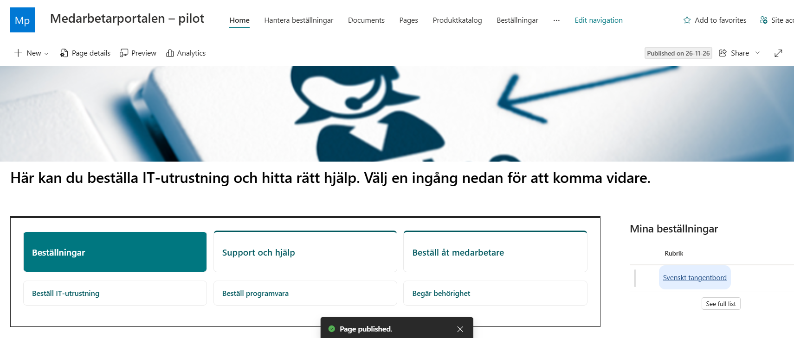
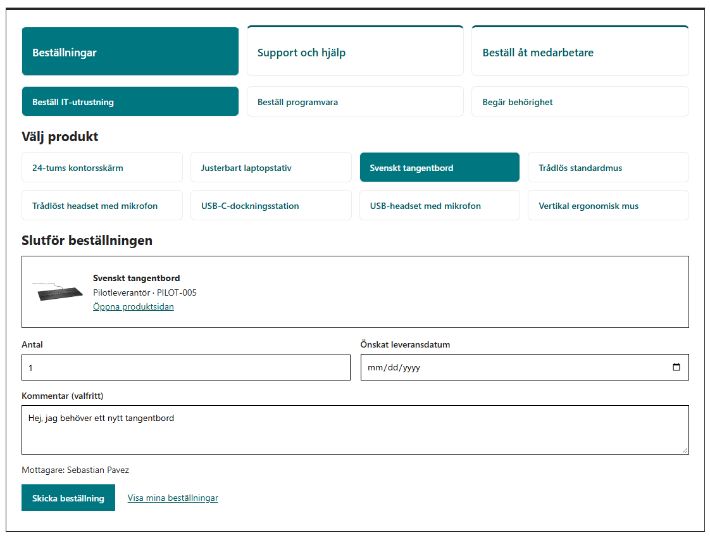
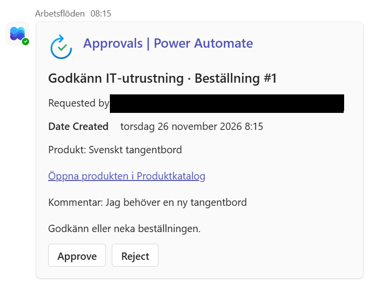
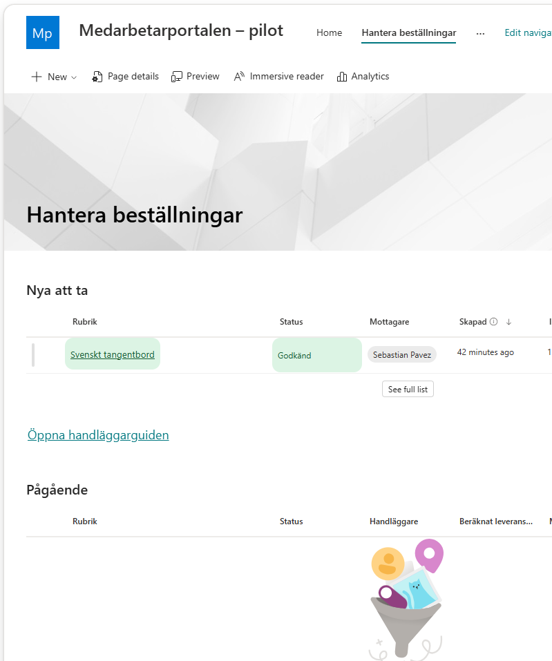
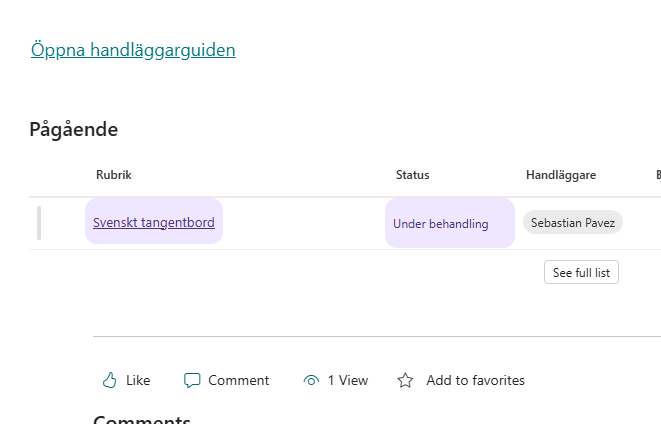
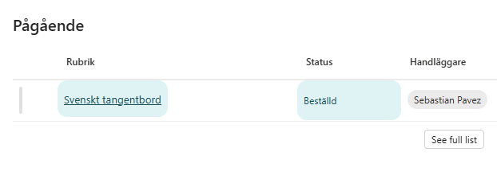
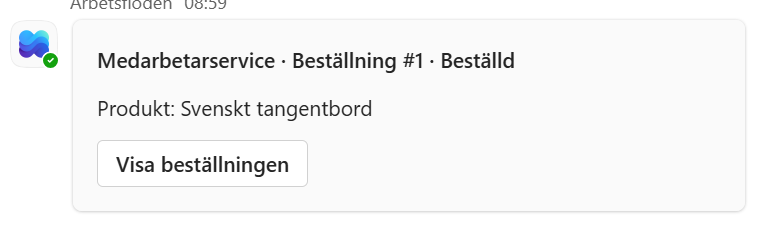
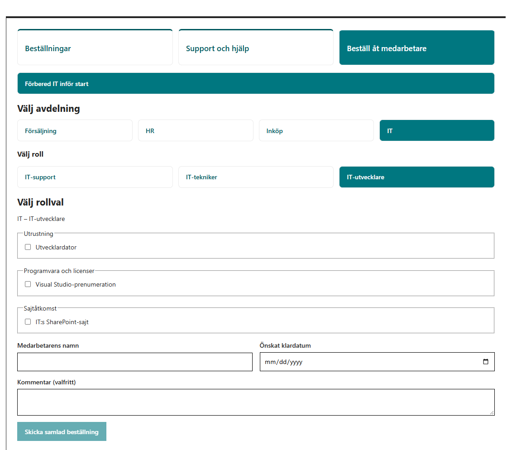
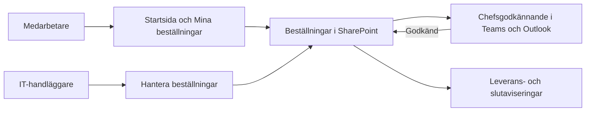

# Medarbetarportalen

Medarbetarportalen är en SharePoint-pilot för interna IT-beställningar och support. Medarbetaren hittar rätt tjänst från en gemensam startsida. IT och inköp kan förvalta sortimentet och ändra vilka tjänster som visas direkt i SharePoint.

*Startsidan samlar beställningar, support och en separat ingång för chefer.*

## Så går en beställning till

Medarbetaren väljer en produkt, anger antal och kan lägga till önskat leveransdatum och kommentar. Beställningen får ett ärendenummer i SharePoint. Chefen får en begäran i Teams och Outlook. Efter ett godkännande kan IT ta ärendet, ange leveransuppgifter och avsluta beställningen när utrustningen har lämnats ut.

*Medarbetaren väljer Svenskt tangentbord och granskar produktbild, artikelnummer, antal och mottagare inför inskick.*

*Chefen får beställning #1 för godkännande i Teams.*

*Den godkända beställningen visas under Nya att ta i IT:s handläggarvy.*

| Under behandling | Beställd |
|---|---|
|  |  |

*När IT sätter status till Beställd får beställaren ett Teams-kort med en länk tillbaka till ärendet.*

## Beställ åt medarbetare

I förhandsvisningen väljer chefen avdelning och roll. För IT-utvecklare visar formuläret utvecklardator, Visual Studio-prenumeration och åtkomst till IT:s SharePoint-sajt. Inskick av chefsbeställningar är avstängt under förhandsvisningen.

## Översikt

## Beställningsarkitektur

**Huvudkategorier** och **Tjänster** styr vad beställaren ser på startsidan. SPFx visar aktiva produkter ur rätt del av **Produktkatalog** och sparar beställningen med produktuppslag och uppgifter från katalogen. Power Automate hämtar beställarens chef från Entra ID. Chefen kan godkänna i Teams eller Outlook. **Mina beställningar** visar status på samma SharePoint-post.

## Handläggararkitektur

Godkända beställningar utan handläggare visas under **Nya att ta**. Tilldelade ärenden hanteras under **Pågående**. När handläggaren sätter **Beställd** får beställaren en avisering med leveransuppgifter om de finns. När ärendet **Avslutas** får både beställaren och chefen en slutavisering. Medarbetar- och handläggarguiden har varsin sida.

## Verktyg

| Verktyg | Användning |
|---|---|
| SharePoint Online och Microsoft Lists | Portal, produktkatalog, beställningar, vyer, behörigheter och guider. |
| SPFx och TypeScript | Produktval och beställningsformulär på startsidan. |
| Power Automate, Approvals, Entra ID och Office 365 Users | Chefsuppslag, chefsgodkännande och aviseringslogik. |
| Teams och Outlook | Godkännanden och beställningsuppdateringar. |
| PowerShell, PnP.PowerShell, npm och Heft | Installation, verifiering och paketering. |

## Provisionering och kundworkshop

PowerShell och PnP.PowerShell används för att skapa sajten, grupperna, listorna och innehållstyperna samt installera SPFx. **Plan** visar stegen, **Apply** utför dem och **Verify** läser tillbaka konfigurationen.

I kundworkshoppen bestäms vilka beställningstyper som ingår, vilka fält som krävs och vem som ansvarar för åtkomst, godkännande och handläggning. Kundkonfigurationen kan exempelvis lägga till **Kostnadsställe** för utrustning eller skapa typen **Beställ kontorsmaterial** med egna fält och ett SharePoint-formulär.

## Verifiering och fortsatt arbete

- **Verifierat i utrustningspiloten.** Beställning #1 godkändes i Teams, hanterades i IT:s kö och gav en Teams-avisering vid **Beställd**.
- **Återstår inför bredare införande.** Hantering av avslag och saknad chef, kontroll av behörigheter och godkännandestatus vid inskick samt nyinstallation i en annan miljö.
- **Utökad omfattning.** Inskick av chefsbeställningar, stöd för rollbyte, programvarans formulärkoppling och externa felanmälningslänkar återstår.
