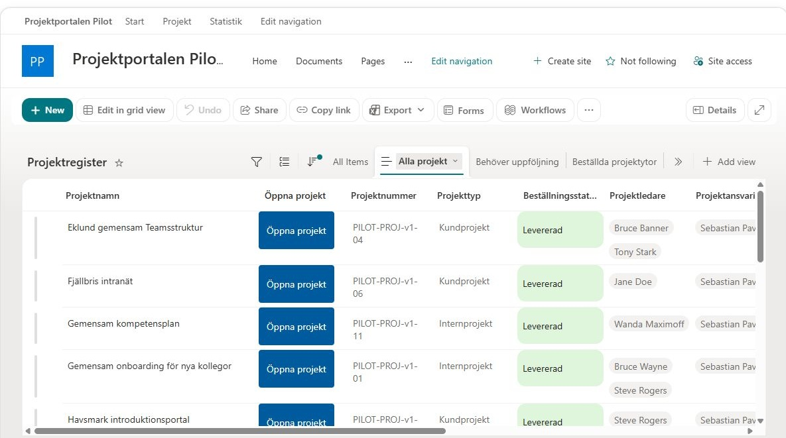
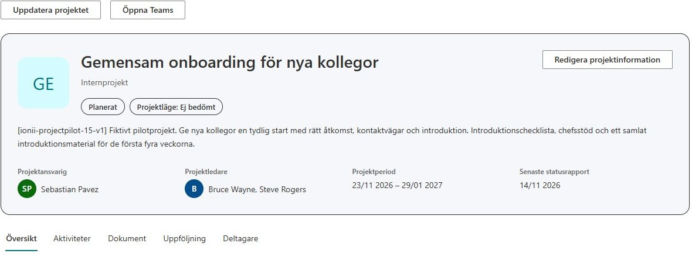
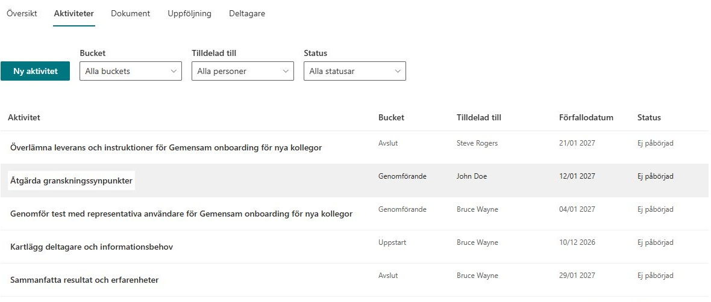
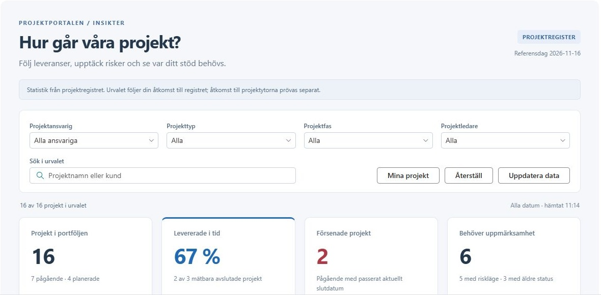
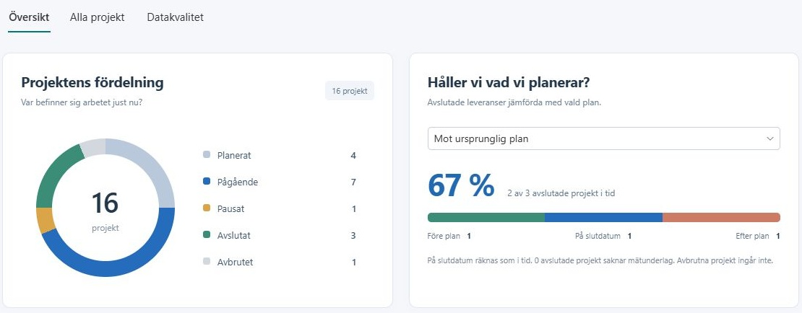

# Projektportalen

[Till portföljens startsida](../README.md)

## Behov och mål

Projektansvariga och projektledare behöver kunna beställa en arbetsyta, hitta projektets resurser och följa upp arbetet utan att själva sätta upp alla tjänster. Projektportalen samlar projektregister, Teams, SharePoint och Planner bakom en gemensam portal.

## Mitt arbete

Jag utvecklar registermodell, provisioneringsmotor och separata SPFx-appar för projektdashboard och statistik. Arbetet omfattar roller, projektmallar, dokumentstruktur, Planner-aktiviteter, API-integrationer, felhantering och workshopunderlag för kundens val.

## Från beställning till levererad arbetsyta

Registret beskriver projektets typ, ansvarig, projektledare, medlemmar och datum. Provisioneringsmotorn läser beställda projekt och skapar Microsoft 365-grupp, Team, kanaler, SharePoint-bibliotek, dokumentmallar och Planner-plan med startuppgifter.

Resurs-ID:n, länkar och leveransstatus sparas på samma registerpost. Status för beställningen hålls separat från projektets verksamhetsfas och projektläge. I piloten startas körningen manuellt i PowerShell.

*Knappen Öppna projekt använder listobjektets ID för att öppna rätt projekt på en gemensam dashboardsida.*

## Ett valt projekts dashboard

En gemensam ASPX-sida i hubben visar projektet som anges med `projectId`. Sidan skapas inte på nytt för varje projekt. Projekt-ID:t är ett urval och ger inga extra behörigheter.

*Pilotprojekt ID 2 med ansvarig, två projektledare, datum och senaste statusrapport.*

Projektkortet kompletteras med flikarna **Översikt, Aktiviteter, Dokument, Uppföljning och Deltagare**. Redigering sker i Fluent UI-paneler. SharePoint REST används för projektposten och Microsoft Graph för Planner.

*Aktiviteter för samma projekt med bucket, tilldelning, förfallodatum och status. Bilden visar ett utsnitt av åtta uppgifter.*

Utvecklade skrivflöden omfattar projektuppdatering och Planner-uppgifter med beskrivning, tilldelning, datum och status. ETag-kontroller hanterar samtidiga ändringar. Skrivflödena är provade mot en lokal testkopia; verkliga skrivprov och separata rolltester återstår.

## Statistik över portföljen

En separat app sammanställer projektregistrets uppgifter. Urval görs efter bland annat projektansvarig, projekttyp, fas och projektledare. Datumfälten skiljer ursprunglig plan, aktuell plan och faktiskt slutdatum.

*Bilderna visar 16 pilotprojekt. Leveransprecisionen 67 procent är ett exempel från testdata och bygger på två av tre mätbara avslutade projekt. Det är inte en uppmätt verksamhetsförbättring.*

## Pilot och nästa steg

Det första testprojektet kompletteras av 15 projekt med varierande typ, datum och status. De 15 har Teams-ytor, två bibliotek per projekt, Planner-planer med åtta aktiviteter per projekt samt sammanlagt 60 testdokument.

Dashboard och statistik är installerade och publicerade. Autentiserad läsning av register och Planner är verifierad. Automatisk beställningsprövning, obevakad Azure-drift och arkivering är fortsatt utveckling. Extern delning och kundens gästmodell behöver beslutas och provas inför ett kundinförande.
